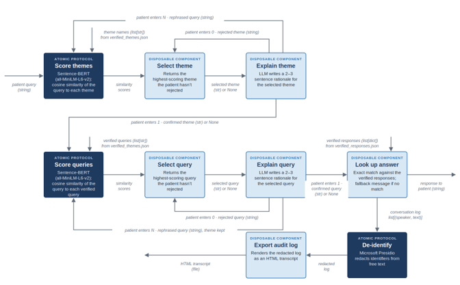

# historical-clinic

[](https://github.com/agentic-systems-2026/historical-clinic/actions/workflows/tests.yml)

An agentic workflow that routes a patient's question to a pre-written answer in the voice of a historical physician (Galen, Avicenna, William Harvey, and others), then saves a de-identified audit log of the conversation. It is the worked example for EPID 695/895, Agentic AI in Healthcare and Public Health (CUNY SPH).

**This is a teaching example. Its answers are not medical advice.**

## How it works



The patient types a question. The workflow scores it against ten themes and offers the closest one, with a short AI-written explanation. The patient confirms (`1`), rejects (`0`, to see the next theme), or rephrases (`N`). The same loop then picks a verified question within the confirmed theme. Its stored answer is shown to the patient, and the whole conversation is de-identified and saved as an HTML audit log.

The workflow is agentic because an LLM processes text inside two components (Explain theme and Explain query). The routing itself is deterministic, so the same replies always reach the same answer.

## Components

| Component | Type | File | Input → output |
|---|---|---|---|
| Score themes, Score queries | Atomic protocol: [Sentence-BERT](https://www.sbert.net/) `all-MiniLM-L6-v2` | glue (`score`) | query `str`, candidates `list[str]` → cosine similarities `list[float]` |
| Select theme | Disposable component | `components/select_theme.py` | themes, scores, rejected themes → highest-scoring unrejected theme `str` or `None` |
| Explain theme | Disposable component (LLM) | `components/explain_theme.py`, `prompts/explain_theme.txt` | query, theme → 2–3 sentence rationale `str` |
| Select query | Disposable component | `components/select_query.py` | queries, scores, rejected queries → highest-scoring unrejected query `str` or `None` |
| Explain query | Disposable component (LLM) | `components/explain_query.py`, `prompts/explain_query.txt` | query, verified query → 2–3 sentence rationale `str` |
| Look up answer | Disposable component | `components/look_up_answer.py` | confirmed query `str` or `None`, verified responses → answer `str` (fallback message if no match) |
| De-identify | Atomic protocol: [Microsoft Presidio](https://microsoft.github.io/presidio/) | glue (`deidentify`) | free text `str` → text with identifiers replaced by tags such as `<PERSON>` |
| Export audit log | Disposable component | `components/export_audit_log.py` | redacted log `list[(speaker, text)]` → path of an HTML file |

The two Explain components call Gemma through `components/gemma.py`.

- **Atomic protocols** are cited, reusable tools. Their unit tests (`tests/test_score.py`, `tests/test_deidentify.py`) define the exact calls the glue makes.
- **Disposable components** were written for this workflow. The glue calls them and never rewrites them.
- **The glue** (`historical_clinic.py`) is the only code a coding agent writes from `WORKFLOW.md`.

## Setup

You need Python 3.12 and [Ollama](https://ollama.com/download).

```bash
python -m venv .venv
source .venv/bin/activate        # Windows: .venv\Scripts\activate
pip install -r requirements.txt
python -m spacy download en_core_web_lg
ollama pull gemma3:1b
```

The first run also downloads the Sentence-BERT model (about 90 MB).

## Running the workflow

```bash
python historical_clinic.py
```

Type your question and answer each offer with `1`, `0`, or `N`. The audit log is saved to `audit_logs/` (change this with `--out-dir`).

To replay the synthetic test session instead:

```bash
python historical_clinic.py < tests/data/test_session.txt                    # macOS, Linux
Get-Content tests/data/test_session.txt | python historical_clinic.py        # Windows PowerShell
```

Settings, all optional:

| Variable | Default | Effect |
|---|---|---|
| `HC_GEMMA_MODEL` | `gemma3:1b` | Ollama model tag |
| `OLLAMA_HOST` | `http://localhost:11434` | Ollama server address |
| `HC_LLM` | (unset) | `stub` replaces Gemma with a fixed reply, for testing without Ollama |

## Running the tests

```bash
pytest -v
```

Expected result: **77 passed, 2 xfailed**. The tests stub Gemma automatically where they need to, so Ollama does not have to be running.

| Test file | Covers |
|---|---|
| `test_score.py` | Score: one score per candidate, cosine range, related > unrelated, identical text ≈ 1, truncation of long input, invalid input |
| `test_deidentify.py` | De-identify: names, phones, emails, edge cases, invalid input, known limitations |
| `test_select.py` | Select theme and Select query: ranking, rejection, ties, all rejected, invalid input |
| `test_explain.py` | Explain theme and Explain query: prompt contents, trimming to 3 sentences, empty replies, invalid input |
| `test_gemma.py` | Gemma call: request format, stub mode, helpful error when Ollama is not running |
| `test_look_up_answer.py` | Look up answer: exact match, fallback, and a check that every verified query has an answer |
| `test_export_audit_log.py` | Export audit log: escaping, patient lines marked, no patient text in the file name |
| `test_end_to_end.py` | The whole workflow on the synthetic session, which exercises every branch (N, 1, 0, N, 1) and checks that the audit log is de-identified |

GitHub Actions runs every test on each push and pull request with Gemma stubbed. Every Monday, and on demand from **Actions → tests → Run workflow**, a second job installs Ollama, downloads Gemma, and runs the end-to-end test live.

## Regenerating the glue

`WORKFLOW.md` is a complete set of instructions for a coding agent. Given only `WORKFLOW.md` and the wire diagram, a fresh LLM session writes `historical_clinic.py`, and the regenerated file must pass `pytest -v`. This has been verified with a fresh session, followed by a live run on the test session.

## Data

- `data/verified_themes.json`: 10 themes and their 99 verified questions.
- `data/verified_responses.json`: answers to those questions, written in the voices of 19 historical physicians.
- `tests/data/test_session.txt`: one synthetic patient session. The name and phone number in it are fake.

## Tested versions

sentence-transformers 6.2.0 with model revision `8b3219a92973c328a8e22fadcfa821b5dc75636a`, transformers 5.20.2, torch 2.14.1 (CPU), presidio-analyzer and presidio-anonymizer 2.2.364, spaCy model `en_core_web_lg` 3.8.0, Ollama 0.40.6 with `gemma3:1b`, Python 3.12.

## Known limitations

- **Physician names are redacted in the audit log.** De-identify runs on every log entry, because the LLM's explanations can repeat what the patient wrote, so "Our physician, William Harvey" is saved as "Our physician, &lt;PERSON&gt;".
- **De-identify misses some identifiers and over-redacts others.** Durations such as "for three days" are redacted as dates, and US ZIP codes are not redacted. Both are tested as expected failures (`xfail`), so the suite will flag a Presidio release that changes either behavior.
- **Long input is truncated.** Sentence-BERT reads only the first 256 word pieces of the patient's question.
- **Theme scoring compares the question with short theme names**, so vague questions can rank poorly. Rephrasing (`N`) is the remedy.
- **Gemma's explanations vary in quality** and may not fit the offer well. They never change which answer the patient reaches.

## Citations

- Reimers, N., & Gurevych, I. (2019). Sentence-BERT: Sentence embeddings using Siamese BERT-networks. *Proceedings of EMNLP-IJCNLP 2019*.
- Microsoft Presidio: https://github.com/microsoft/presidio
- Gemma Team, Google DeepMind (2025). Gemma 3 technical report. arXiv:2503.19786.
